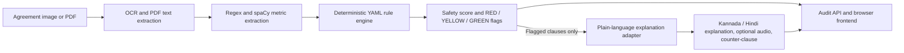

# KararKavach

**KararKavach** is an open civic technology project that helps tenants understand common risks in Indian rental agreements. It extracts agreement text, identifies measurable terms, applies a transparent rulebook, and presents a safety score with plain-language explanations.

The project is intended for awareness and education. Its rulebook is a practical screening aid, not a substitute for advice from a qualified lawyer or a determination of legal rights in a specific case.

## Why this project

Rental agreements can contain terms about deposits, lock-in periods, penalties, and landlord access that are difficult to assess quickly. KararKavach makes its checks inspectable: extraction and scoring run through deterministic Python code, and each triggered rule can be traced to a YAML rule and its stated reference. Flagged clauses can then be explained in plain language, including Kannada and Hindi, with offline template fallbacks.

## Civic QR deployment model

KararKavach can be deployed as a public web service and introduced through QR codes placed at:

- Sub-registrar offices, where people formalize agreements.
- PG and hostel notice boards, where prospective tenants compare terms.
- Legal aid desks, where visitors can use the tool as a starting point for discussion.

A QR code can open the app or its sample audit. For a deployment, pair the code with a short privacy notice and a clear reminder not to upload documents containing information the user does not want processed. The audit API handles uploads in memory; temporary audio responses are served and then removed.

## Architecture



The core decision path is deterministic: OCR and document text extraction feed metric extraction, then the Python rule engine evaluates `rules/tenancy_india.yaml`. The explanation adapter is downstream of the flags and supplies accessible explanations and drafting suggestions; it does not assign scores or decide whether a clause is risky.

## Quickstart

Python 3.10 or newer is recommended. OCR for images requires the Tesseract executable in addition to the Python package. On Debian or Ubuntu, install it with `sudo apt-get install tesseract-ocr`; Windows and macOS users can install Tesseract using their platform's package manager or installer.

```bash
python -m venv .venv
# Activate the virtual environment for your shell, then:
pip install -r requirements.txt
python -m pytest -v
uvicorn app.main:app
```

Open `http://127.0.0.1:8000/` for the frontend, `http://127.0.0.1:8000/docs` for the API documentation, or `http://127.0.0.1:8000/api/v1/audit-sample` for the bundled sample audit.

## Rulebook contributions

Rules live in [`rules/tenancy_india.yaml`](rules/tenancy_india.yaml). Contributions should be specific, explainable, and supported by a reliable legal or policy reference where applicable. The rule engine is deterministic Python; do not move scoring, clause extraction, or red-flag decisions into an LLM or network service.

Each rule follows this shape:

```yaml
- id: UNIQUE_RULE_ID
  description: Short explanation of the condition being checked.
  field: extracted_metric_or_risk_field
  operator: greater_than
  threshold: 6
  severity: YELLOW
  penalty: 10
  legal_reference: Name or citation for the source
```

When proposing a rule:

1. Use a stable, unique `id` and a concise description written for reviewers.
2. Select a field and operator supported by `core/rule_engine.py`; check existing rules for examples such as `greater_than`, `greater_than_or_equal`, and `contains_any`.
3. Set a numeric threshold or keyword list that can be evaluated without interpretation at runtime. Keep severity to `RED` or `YELLOW` and choose a proportionate penalty.
4. Add the source in `legal_reference`. State uncertainty or jurisdictional limits in the description or contribution discussion; do not present a general guideline as binding law.
5. Add or update deterministic tests for the triggering and non-triggering boundary cases, and run `python -m pytest -v`.

Please include a short rationale and relevant source links in the pull request so the rule can be reviewed and maintained as law and policy change.

## Deployment

The repository includes a lightweight Docker image and a Render Blueprint. Render builds the service from `Dockerfile`, installs the system Tesseract OCR executable and Python dependencies, then runs Uvicorn on the port provided by the platform.

## License and contributions

Contributions are welcome. Before distributing or deploying the project, review the repository's license and the legal references relevant to your jurisdiction. Keep user privacy, accessibility, and transparent deterministic checks central to changes.
